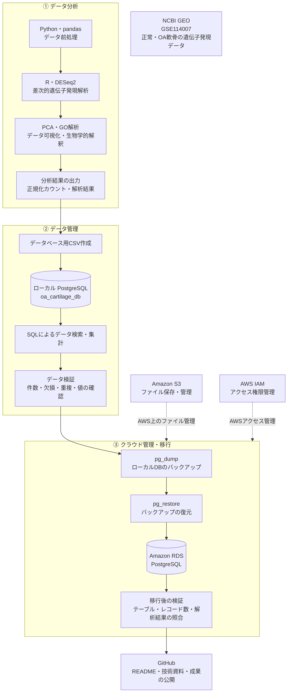

# 関節軟骨遺伝子発現量のデータ解析およびデータベース構築

## 0. 目次
1. プロジェクト概要
2. 使用技術・ツール
3. 全体の流れ（フローチャート）
4. ディレクトリ構成
5. 詳細資料（リンク）

## 1. プロジェクト概要

本プロジェクトでは、正常軟骨と変形性関節症（Osteoarthritis：OA）軟骨の遺伝子発現データ（公開データベース）を用いて、両群間の発現変動遺伝子および関連する生物学的プロセスを解析しました。

私自身が怪我を経験したことから、軟骨の損傷や変性、再生に関わる生物学的な仕組みに関心を持ち、その理解を深めるために本テーマを選択しました。

バイオインフォマティクスの解析工程：RおよびPythonによるデータ処理、統計解析、可視化を実践し、データから生物学的な特徴を読み取ること。
そして、分析結果を再利用可能な形で管理するとともに、データベース構築からクラウド移行、移行後のデータ整合性確認までの一連の工程を実践することを目的としています。

## 2. 使用技術・ツール

| 分類 | 使用技術・ツール |
|---|---|
| プログラミング言語 | R、Python |
| 統計解析 | DESeq2 |
| 機能解析 | clusterProfiler、org.Hs.eg.db |
| データ可視化 | ggplot2 |
| データ前処理 | Python、pandas |
| データソース | NCBI GEO（GSE114007） |
| 開発環境 | WSL Ubuntu、JupyterLab |
| データベース | PostgreSQL |
| データベース操作 | SQL、psql |
| データベース移行 | pg_dump、pg_restore |
| クラウドデータベース | Amazon RDS for PostgreSQL |
| クラウドストレージ | Amazon S3 |
| クラウドアクセス管理 | AWS IAM |
| クラウド基盤 | Amazon Web Services（AWS） |
| バージョン管理 | Git、GitHub |

## 3. プロジェクト全体の流れ
遺伝子発現データの分析から、データベース管理、クラウド環境への移行までを一連の流れとして実施しました。
全体構成を示します。



## 4. ディレクトリ構成

```TEXT
bioinformatics/
├── data/
│   ├── raw/
│   └── processed/
├── docs/
│   ├── analytics/
│   │   ├── 解析方法.md
│   │   ├── 解析結果.md
│   │   ├── 考察.md
│   │   ├── 参考文献.md
│   │   └── README.md
│   └── data_management/
│       ├── AWS構築・データ移行.md
│       ├── データベース設計.md
│       ├── 問題と改善方法.md
│       └── README.md
│       
├── notebooks/
├── scripts/
├── results/
└── README.md
```

## 5. 詳細資料

各解析とデータ管理の詳細は、以下を参照してください。

[データ分析TOP（analytics）](docs/analytics/)
- [解析方法](docs/analytics/解析方法.md)
- [解析結果](docs/analytics/解析結果.md)
- [考察](docs/analytics/考察.md)
- [参考文献](docs/analytics/参考文献.md)

[データ管理TOP（data_management）](docs/data_management/)
- [AWS構築・データ移行](docs/data_management/AWS構築・データ移行.md)
- [データベース設計](docs/data_management/データベース設計.md)
- [問題と改善方法](docs/data_management/問題と改善方法.md)

